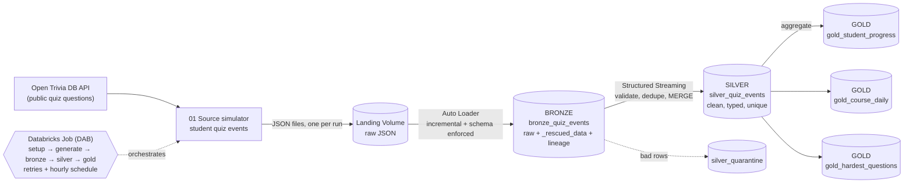

# EdTech Learning Analytics: Medallion Pipeline on Databricks

An end-to-end **Bronze → Silver → Gold** pipeline that ingests quiz-attempt events from an online
learning platform, cleans them, and produces teacher- and product-ready analytics tables.

**Stack:** Databricks (Unity Catalog, Volumes) · PySpark · Delta Lake · Auto Loader · Structured Streaming · Databricks Jobs / Asset Bundles
**Data:** Real quiz questions from the public [Open Trivia DB API](https://opentdb.com) + simulated student attempts (with deliberately dirty records).

## Architecture



## What each layer guarantees

| Layer | Table | Guarantee |
|---|---|---|
| Bronze | `bronze_quiz_events` | Nothing is lost. Raw data + `_source_file` + `_ingested_at`. Unexpected columns / bad types go to `_rescued_data`. |
| Silver | `silver_quiz_events` | Valid, typed, **unique by `event_id`**. Protected by `NOT NULL` + `CHECK` constraints. |
| Silver | `silver_quarantine` | Every rejected row is kept with a reason (no silent data loss). |
| Gold | `gold_*` | Aggregated, business-friendly tables for dashboards. |

## Key engineering decisions

- **Auto Loader + `availableNow`**: incremental file discovery with checkpointing; runs like a batch job (cheap) but never reprocesses old files.
- **Explicit schema + `rescue` mode**: schema is *enforced*, but drift never crashes the pipeline or loses data.
- **`foreachBatch` + `MERGE` on `event_id`**: idempotent writes, so retries and replays cannot create duplicates.
- **Quarantine pattern**: bad data is isolated and auditable instead of dropped.
- **Delta CHECK constraints**: second line of defence at the storage layer.
- **Orchestration as code**: `databricks.yml` defines a 5-task Job with dependencies, retries and a (paused) hourly schedule.

## Repo layout

```
src/
  00_setup.py                 schema + volumes
  01_generate_source_data.py  API pull + event simulator (injects dirty data)
  02_bronze_autoloader.py     Auto Loader -> Bronze
  03_silver_clean.py          validate / dedupe / MERGE -> Silver (+ quarantine)
  04_gold_aggregates.py       3 Gold tables
databricks.yml                Job definition (Databricks Asset Bundle)
docs/INTERVIEW_GUIDE.md       ELI5 explanations + Q&A
```

## How to run

**Option A: UI (works on Databricks Free Edition)**
1. Push this repo to GitHub → in Databricks: *Workspace → Create → Git folder* → paste your repo URL.
2. Run `src/00_setup.py`, then `01` → `02` → `03` → `04` in order. Run `01` 2–3 times and re-run `02`–`04` to see **incremental loading**.

**Option B: Job via Databricks CLI**
```bash
databricks bundle validate
databricks bundle deploy -t dev
databricks bundle run edtech_medallion_pipeline
```

## Try these experiments (great for demos)

```sql
-- Did duplicates get removed?
SELECT count(*) AS total, count(DISTINCT event_id) AS uniq FROM silver_quiz_events;

-- What got rejected?
SELECT count(*) FROM silver_quarantine;

-- Did schema drift get caught instead of crashing?
SELECT _rescued_data FROM bronze_quiz_events WHERE _rescued_data IS NOT NULL LIMIT 5;

-- Re-run the Bronze notebook with no new files: row count must not change (incremental).
```

## Possible extensions
Lakeflow Declarative Pipelines (expectations) version · Databricks SQL dashboard on Gold · unit tests for the validation rules · real-time via Kafka/Event Hubs instead of files.
